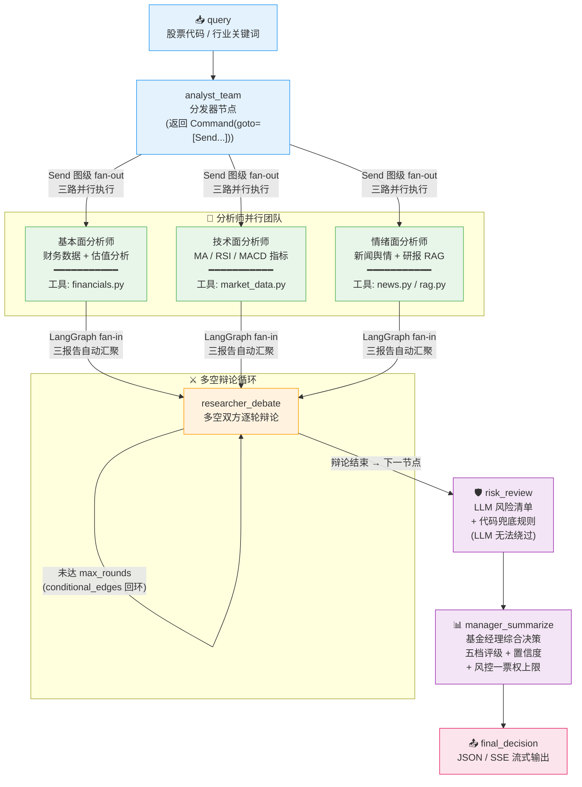

<p align="center">
  <h1 align="center">🏦 AgentCouncil</h1>
  <p align="center">
    <strong>多智能体金融分析系统</strong><br>
    三分析师并行 → 多空辩论 → 风控评审 → 基金经理五档评级<br>
    <em>过程可解释 · 结果可追溯 · 容错不中断</em>
  </p>
</p>

<p align="center">
  
  
  
  
  
  
  
</p>

> **声明**：本项目为独立实现，不基于任何既有开源项目；LangGraph / Pydantic / Milvus / AkShare / DeepSeek 等仅作为基础设施、数据源与模型服务使用。

---

## 📑 目录

- [📑 目录](#-目录)
- [✨ 核心特性](#-核心特性)
- [🏗 架构设计](#-架构设计)
  - [运行时流程（Agent 执行链路）](#运行时流程agent-执行链路)
  - [SSE 事件时序](#sse-事件时序)
  - [共享状态（CouncilState）](#共享状态councilstate)
- [🚀 快速开始](#-快速开始)
- [📦 安装与部署](#-安装与部署)
  - [详细环境配置](#详细环境配置)
  - [Milvus 本地库](#milvus-本地库)
  - [启动 SSE 流式服务](#启动-sse-流式服务)
- [⚙️ 配置参考](#️-配置参考)
- [📖 使用指南](#-使用指南)
  - [CLI 命令行](#cli-命令行)
  - [测试套件](#测试套件)
  - [API 端点](#api-端点)
- [📁 项目结构](#-项目结构)
- [🧪 评测结果](#-评测结果)
- [🔒 数据真实性声明](#-数据真实性声明)
  - [✅ 真实实现](#-真实实现)
  - [⚠️ 降级场景（如实留痕，绝不伪造数据）](#️-降级场景如实留痕绝不伪造数据)
  - [🛡️ 代码兜底规则（LLM 无法绕过）](#️-代码兜底规则llm-无法绕过)
  - [📐 Milvus 索引选型](#-milvus-索引选型)
- [📄 许可证](#-许可证)

---

## ✨ 核心特性

- **🔬 三分析师并行**：基本面、技术面、情绪面 —— LangGraph Send 图级 fan-out 并行执行，角色各司其职，不互相替代
- **⚔️ 多轮多空辩论**：研究员多空双方逐轮辩论，conditional_edges + max_rounds 防死循环，辩论全程可追溯
- **🛡️ 风控一票权**：LLM 风险清单 + 代码兜底规则（LLM 无法绕过）→ 高风险上限减持 / blocked 强制卖出
- **📊 五档评级体系**：买入(Buy) / 增持(Overweight) / 中性(Hold) / 减持(Underweight) / 卖出(Sell)，经理综合决策 + 置信度
- **🔄 全链路 fail-open**：工具失败 → `ToolResult(ok=False)`，Agent 失败 → `status=failed` 合法结构化输出，节点失败 → 降级产物 + 错误留痕 `state.errors`，**任何单点失败不中断整条链路**
- **🌐 真实数据接入**：AkShare 行情（MA/RSI/MACD）、东财估值/同花顺财务摘要、个股新闻；Milvus + bge 研报向量检索
- **🧠 DeepSeek LLM 全节点**：分析师/研究员/风控/经理均由 DeepSeek 生成（json_mode 结构化输出 + Pydantic 校验），未配 key 自动降级模板
- **📡 FastAPI + SSE 流式**：`GET /stream` 逐步推送各角色报告与最终决策，异常以 `error` 事件推送、不中断流
- **📋 真实评测体系**：LLM-as-Judge 报告质量评审（事实性/相关性/无幻觉/辩论有效性），每次运行渲染 Markdown + HTML 报告

---

## 🏗 架构设计

### 运行时流程（Agent 执行链路）




### 共享状态（CouncilState）

| 字段 | 说明 |
|------|------|
| `query` | 用户输入（股票代码/行业关键词） |
| `messages` | 消息历史（可追溯 + LLM 上下文预留） |
| `analyst_reports` | 三分析师报告聚合（并行产出） |
| `debate_round` / `debate_history` | 辩论轮次与完整记录 |
| `debate_report` | 辩论汇总报告 |
| `risk_report` | 风控评审结果 |
| `final_decision` | 基金经理最终决策（评级 + 置信度 + 摘要 + 风险提示） |
| `errors` | 全链路错误留痕 |


---

## 🚀 快速开始

**前置要求**：Python ≥ 3.10、Docker（Milvus 本地库）

```bash
# 1. 克隆仓库
git clone <your-repo-url> && cd AgentCouncil

# 2. 安装依赖
pip install -r requirements.txt

# 3. 配置环境变量
cp .env.example .env
# 编辑 .env，填入 DEEPSEEK_API_KEY（可选，缺失时自动降级模板）

# 4. 启动 Milvus（Docker）
docker run -d --name milvus-standalone \
  -p 19530:19530 -p 9091:9091 \
  milvusdb/milvus:v3.0.0 milvus run standalone

# 5. 构建研报知识库（首次含模型下载）
python data/ingest.py

# 6. 运行分析
python main.py --query "600519.SH" --show-analysts --show-debate
```

> **提示**：conda 用户可直接使用 `D:/Python/Conda/envs/agentcouncil` 虚拟环境（Python 3.12）。如 conda 默认源被 ToS 拦截，创建环境时加 `--override-channels -c https://mirrors.tuna.tsinghua.edu.cn/anaconda/pkgs/main`。

---

## 📦 安装与部署

### 详细环境配置

```bash
# 使用 conda 虚拟环境（项目开发环境，Python 3.12）
conda create -p D:/Python/Conda/envs/agentcouncil python=3.12 -y

# 安装依赖（使用官方 PyPI 源，清华镜像缺少 langgraph）
D:/Python/Conda/envs/agentcouncil/python -m pip install -r requirements.txt -i https://pypi.org/simple
```

### Milvus 本地库

```bash
# 后续使用（容器已创建）
docker start milvus-standalone

# 首次创建
docker run -d --name milvus-standalone \
  -p 19530:19530 -p 9091:9091 \
  milvusdb/milvus:v3.0.0 milvus run standalone
```

> **注意**：容器重启后集合不会自动加载，`research_rag` 首次检索会自愈重载（`tools/rag.py`）。

### 启动 SSE 流式服务

```bash
D:/Python/Conda/envs/agentcouncil/python -m uvicorn api.server:app --host 127.0.0.1 --port 8000

# SSE 流式（逐步推送各角色报告与最终决策）
curl -N "http://127.0.0.1:8000/stream?query=600519.SH"

# 非流式最终决策 JSON
curl "http://127.0.0.1:8000/analyze" -X POST \
  -H "Content-Type: application/json" \
  -d '{"query":"600519.SH"}'
```

---

## ⚙️ 配置参考

复制 `.env.example` 为 `.env` 按需修改；所有配置项均有默认值，缺失时回退默认（fail-open）。

| 变量 | 默认值 | 说明 |
|------|--------|------|
| `MOCK_MODE` | `false` | `false`=真实数据；`true`=全 mock（冒烟测试固定 true） |
| `DEBATE_MAX_ROUNDS` | `3` | 多空辩论最大轮数（≥1，防死循环） |
| `DEMO_TOOL_FAILURE` | `false` | `true` 时数据工具故意失败（演示 fail-open） |
| `DEEPSEEK_API_KEY` | — | DeepSeek 密钥（缺失时 Agent 降级模板 + 留痕） |
| `DEEPSEEK_BASE_URL` | `api.deepseek.com` | OpenAI 兼容端点 |
| `DEEPSEEK_MODEL` | `deepseek-chat` | 模型名称 |
| `MILVUS_HOST` | `localhost` | Milvus 本地库地址 |
| `MILVUS_PORT` | `19530` | Milvus 端口 |
| `MILVUS_COLLECTION` | `research_docs` | 研报向量集合名 |
| `BGE_MODEL` | `BAAI/bge-large-zh-v1.5` | bge 嵌入模型（可换 bge-m3） |
| `HF_ENDPOINT` | `https://hf-mirror.com` | HuggingFace 下载镜像 |
| `HF_HOME` | `D:/Python/hf-cache` | 模型缓存目录（约 1.3GB，勿放 C 盘） |
| `MARKET_HISTORY_DAYS` | `400` | 行情历史回看窗口（自然日） |

---

## 📖 使用指南

### CLI 命令行

```bash
# 完整链路（三分析师报告 + 逐轮辩论详情）
python main.py --query "600519.SH" --show-analysts --show-debate

# 精简输出（仅最终决策）
python main.py --query "600519.SH"

# 行业关键词
python main.py --query "新能源汽车"
```

### 测试套件

```bash
# mock 链路冒烟测试（固定 MOCK_MODE=true，3 场景）
python -m eval.smoke_test

# 真实数据链路测试（6 场景：RAG/行情/财务/新闻 + 全链路 + fail-open）
python -m eval.real_data_test

# DeepSeek 接入测试（4 场景：分析师/研究员/风控/经理，需 API key）
python -m eval.llm_test

# FastAPI + SSE 测试（3 场景：事件序列/辩论轮数上限/故障降级）
python -m eval.api_test

# 并行 vs 串行端到端耗时对比（Send 图级并行 vs 单节点串行，真实计时）
python -m eval.parallelism_test
```

### API 端点

| 端点 | 方法 | 说明 |
|------|------|------|
| `/stream?query=<str>` | `GET` | SSE 流式推送（各角色报告 + 最终决策） |
| `/analyze` | `POST` | 非流式最终决策 JSON |
| `/health` | `GET` | 健康检查 |

---

## 📁 项目结构

```
AgentCouncil/
├── CLAUDE.md                # 项目规约（架构/技术栈/约束）
├── README.md                # 本文件
├── requirements.txt         # Python 依赖
├── .env.example             # 环境变量配置示例
├── config.py                # 全局配置（环境变量读取，fail-open 回退）
├── main.py                  # CLI 入口（graph.invoke → final_decision JSON）
│
├── agents/                  # Agent 实现（DeepSeek LLM 主路径 + 模板降级）
│   ├── schemas.py           # Pydantic v2 结构化输出 schema（extra="forbid" + 业务校验）
│   ├── base.py              # Agent 基类（fail-open 执行骨架）
│   ├── llm.py               # DeepSeek 封装（OpenAI 兼容 + json_mode 结构化输出）
│   ├── analyst.py           # 三分析师（基本面/技术面/情绪面，Send 并行）
│   ├── researcher.py        # 多空辩论研究员（逐轮产出 + 最终轮收敛）
│   ├── risk.py              # 风控评审（LLM 清单 + 代码兜底规则）
│   └── manager.py           # 基金经理汇总（LLM 决策 + 风控一票权上限）
│
├── graph/                   # LangGraph 链路
│   ├── state.py             # CouncilState 共享状态定义
│   ├── nodes.py             # 节点实现（Send 分发 / 辩论循环 / 节点级 fail-open）
│   └── builder.py           # StateGraph 构建（conditional_edges + MemorySaver checkpointer）
│
├── tools/                   # 工具层（schema 与 mock 完全对齐）
│   ├── base.py              # 工具基类 + ToolResult（ok / data / error）
│   ├── market_data.py       # 行情：AkShare 前复权日线 → MA/RSI/MACD
│   ├── financials.py        # 财务：东财估值（PE/PB）+ 同花顺财务摘要（ROE/增速）
│   ├── news.py              # 新闻：东财个股新闻（标题/来源/链接/时间/摘要）
│   ├── rag.py               # RAG：Milvus 向量检索 + bge 查询编码
│   └── mock_tools.py        # mock 工具 + 双模式路由（MOCK_MODE 控制）
│
├── data/                    # 数据层
│   ├── raw/                 # 研报 PDF（ingest 自动下载，明细见 sources.json）
│   ├── embedder.py          # bge 嵌入模型（本地加载，归一化向量）
│   └── ingest.py            # 建库脚本：PDF → 切分 → 向量化 → Milvus（HNSW 索引）
│
├── api/                     # 服务层
│   └── server.py            # FastAPI + SSE 流式（/stream /analyze /health）
│
└── eval/                    # 评测体系
    ├── smoke_test.py        # mock 链路冒烟测试（3 场景）
    ├── real_data_test.py    # 真实数据链路测试（6 场景）
    ├── llm_test.py          # DeepSeek 接入测试（4 场景）
    ├── api_test.py          # FastAPI + SSE 测试（3 场景）
    ├── parallelism_test.py  # 并行 vs 串行耗时对比
    ├── run_eval.py          # 真实评测驱动：N 次运行存档 + 一致性/延迟统计
    ├── judge.py             # LLM-as-Judge：报告质量 + 辩论有效性评审
    ├── render_report.py     # 评测报告渲染（Markdown + 自包含 HTML）
    ├── runs/                # 运行产物（run_NNN.json / metrics.json / judge_results.json）
    ├── reports/             # 渲染报告（run_NNN.md|html / SUMMARY.md|html）
    └── README.md            # 评测详细说明
```

---

## 🧪 评测结果

> **2026-11-02 实测**，同 ticker 600519.SH 串行 5 次完整真实链路，全部数字来自真实运行统计。
>
> 评测流水线：`eval/run_eval.py` → `eval/judge.py`（DeepSeek LLM-as-Judge，评审 prompt 独立于生产链路） → `eval/render_report.py`。

| 维度 | 指标 | 实测结果 |
|------|------|----------|
| **决策一致性** | 评级分布（5 次） | 减持 ×4、中性 ×1，**一致率 80%**（众数：减持） |
| | 置信度 | 均值 0.62，标准差 0.00（温度 0.2 下高度稳定） |
| **端到端延迟** | 总耗时 | 均值 **32.17s**，P95 **43.88s**，最小 26.52s（n=5） |
| | 分阶段均值 | 分析师并行 7.57s / 辩论 15.68s / 风控 4.83s / 经理 4.09s |
| **报告质量** | LLM-as-Judge（15 份） | 事实性 **4.93/5**、相关性 **4.93/5**、无幻觉 **4.80/5** |
| **幻觉率** | 论点级有据判定 | 有据 **56/56（100%）**，无据 0%；引用来源比例 100% |
| **辩论有效性** | LLM-as-Judge（5 次） | 多方交锋 **4.0/5**、空方交锋 **5.0/5**、对立覆盖 **4.2/5** |
| **稳定性** | 管线错误留痕 | 5 次共 **0 条**；辩论双侧论点比例 100% |

<details>
<summary>📋 评测口径说明（诚实性声明）</summary>

- **幻觉率**：评审对每条核心论点判定「是否由分析师收到的同一份工具数据支持」的无据占比。评审基准数据在评审时按与生产链路相同的工具取数重建；评审失败如实留痕（本批次 0 次失败），不伪造分数。
- **一致性/延迟**：5 样本小样本统计，供演示参考。

</details>

---

## 🔒 数据真实性声明

### ✅ 真实实现

| 组件 | 数据来源 | 产出内容 |
|------|---------|---------|
| `get_market_data` | AkShare 前复权日线 | 现价 + MA5/20/60、RSI14、MACD(12,26,9) |
| `get_financials` | AkShare 东财估值 + 同花顺财务摘要 | PE/PB、ROE、营收增速、净利增速、报告期 |
| `get_news` | AkShare 东财个股新闻 | 标题/来源/链接/时间/摘要 |
| `research_rag` | Milvus + bge 向量检索 | chunk 附带 metadata（ticker/date/source/page） |
| `calculator` / `get_date` | 本地实现 | 计算器 + 日期工具 |
| 全部 Agent | DeepSeek LLM（json_mode） | Pydantic 校验结构化输出，`note` 标注「真实数据 + DeepSeek 生成」 |
| 技术面降级模板 | 三信号投票规则 | 置信度真实计算 |

### ⚠️ 降级场景（如实留痕，绝不伪造数据）

- LLM 不可用（未配 key / 网络失败）→ Agent 降级为确定性模板，`note` 标注「【降级模板】」+ 错误留痕
- 数据字段缺失（如亏损股 PE 为 NaN、无新闻）→ 工具返回 `ok=False` + 指明缺失字段
- `MOCK_MODE=true` → 全部走 mock，schema 与真实实现完全对齐

### 🛡️ 代码兜底规则（LLM 无法绕过）

- 风控「信息不完整」→ 必上高风险
- 整体风险等级 → 取清单最高
- 经理评级 → 受风控一票权上限约束：高风险 → 上限减持 / blocked → 强制卖出

### 📐 Milvus 索引选型

HNSW（COSINE，M=16，efConstruction=200，检索 ef=64）。库规模小（数百~数千 chunk），HNSW 无需训练、召回率高、查询毫秒级，是小库单机场景最优解。详见 [data/ingest.py](data/ingest.py)。

---

## 📄 许可证

本项目基于 [MIT License](LICENSE) 开源，可自由使用、修改与分发（需保留版权声明与许可声明）。

---